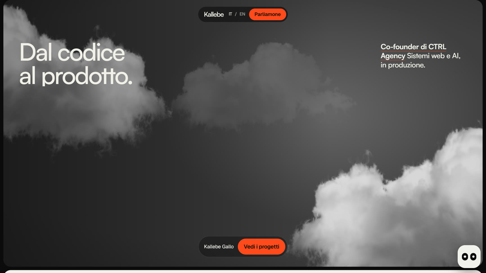
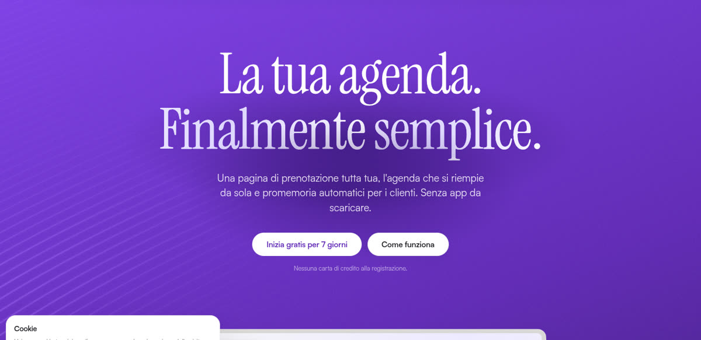
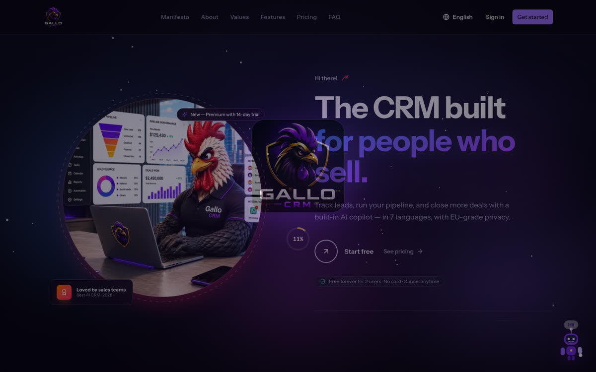

# Kallebe Gallo — Portfolio

> **Dal codice al prodotto.** — An interactive, multilingual portfolio for an AI Full-Stack engineer and co-founder of [CTRL Agency](https://www.ctrlagency.dev/).

<p align="center">
  <a href="https://kallebegallo.ctrlagency.dev"><strong>▶ Live site — kallebegallo.ctrlagency.dev</strong></a>
</p>

<p align="center">
  
</p>

<p align="center">
  
  
  
  
  
  
</p>

---

## Overview

A single-page, no-framework portfolio built for speed and craft. It pairs an editorial layout with lightweight WebGL scenes and scroll-driven storytelling — all from three source files and a handful of optimized images.

- **Zero build step.** Plain HTML, CSS and ES modules — open `index.html` and it runs.
- **Interactive 3D.** Three.js scenes (hero ring, stack staircase, experience cubes) loaded on demand and paused when off-screen.
- **Scroll as narrative.** The *Chi sono* and *Stack* sections advance their content as you scroll, on desktop and mobile.
- **Bilingual.** Italian / English, switched live and remembered in `localStorage`.
- **Responsive.** Tuned from large desktops down to small phones, with smooth touch scrolling.

## Features

| | |
|---|---|
| 🎛️ **WebGL scenes** | `three.js` ring + icosahedron hero, a 4-layer stack "staircase", and floating experience cubes — software-light and lazy-mounted |
| 🌍 **i18n (IT/EN)** | Every string driven by `data-i18n`; language persisted across visits |
| 📜 **Scroll-driven UI** | `IntersectionObserver` reveals, animated counters, and progress-linked section states |
| 🧭 **Smooth scroll** | [Lenis](https://github.com/darkroomengineering/lenis) with touch sync, respecting `prefers-reduced-motion` |
| 💬 **"Eye" chat widget** | A playful contact assistant with quick replies |
| ⚡ **Lightweight** | No framework, no bundler; images served as `.webp` with `.jpg` fallbacks |

## Featured projects

Real products showcased in the portfolio:

| [Agenda Easy](https://agendaeasy.it) | [CRM Gallo](https://gallo-crm.vercel.app) |
|:---:|:---:|
|  |  |
| Online booking SaaS — Next.js, Supabase, Stripe | Multi-tenant CRM with an AI copilot — Next.js, Supabase |

## Tech stack

- **Markup & styles:** HTML5, modern CSS (grid, `clamp()`, `svh`, logical properties)
- **Behavior:** Vanilla JavaScript (ES modules), no framework
- **3D:** [Three.js](https://threejs.org/) (ESM via CDN)
- **Smooth scroll:** [Lenis](https://github.com/darkroomengineering/lenis)
- **Fonts:** Geist + Fontshare
- **Hosting:** [Vercel](https://vercel.com/) (static)

## Project structure

```
portafoglio/
├── index.html        # Page structure + content (data-i18n driven)
├── style.css         # All styling and responsive behavior
├── js/
│   ├── main.js       # i18n, interactions, scroll logic, chat widget
│   └── world.js      # Three.js scenes (hero · stack · exp)
├── img/
│   ├── portrait.*    # Profile photo (jpg + webp)
│   ├── clouds/       # Hero cloud layers
│   ├── shots/        # Project screenshots (desktop + mobile)
│   └── readme/       # README assets
├── LICENSE
└── README.md
```

## Run locally

No dependencies and no build. Serve the folder with any static server so ES modules load over `http://`:

```bash
# Python
python -m http.server 5173

# or Node
npx serve .
```

Then open <http://localhost:5173>. (Opening `index.html` directly via `file://` works for layout, but ES modules need an HTTP origin.)

## Deploy

Deployed on Vercel as a static site — no framework preset required.

```bash
npm i -g vercel
vercel --prod
```

## Performance notes

- 3D scenes are **lazy-mounted** via `IntersectionObserver` and **paused** when hidden or when the tab is in the background.
- WebGL device-pixel-ratio is capped (and scene count reduced on mobile) to protect battery and frame rate.
- Images ship as `.webp` with `.jpg` fallbacks; the hero cloud uses a smaller `srcset` on phones.
- Motion honors `prefers-reduced-motion` and can be disabled with `?reveal` for debugging.

## License

Released under the [MIT License](LICENSE).

---

<p align="center">
  Built by <a href="https://kallebegallo.ctrlagency.dev">Kallebe Gallo</a> ·
  <a href="https://www.linkedin.com/in/kallebe-gallo-a55b01211">LinkedIn</a> ·
  <a href="https://github.com/kallebesiqueira-dev">GitHub</a>
</p>
